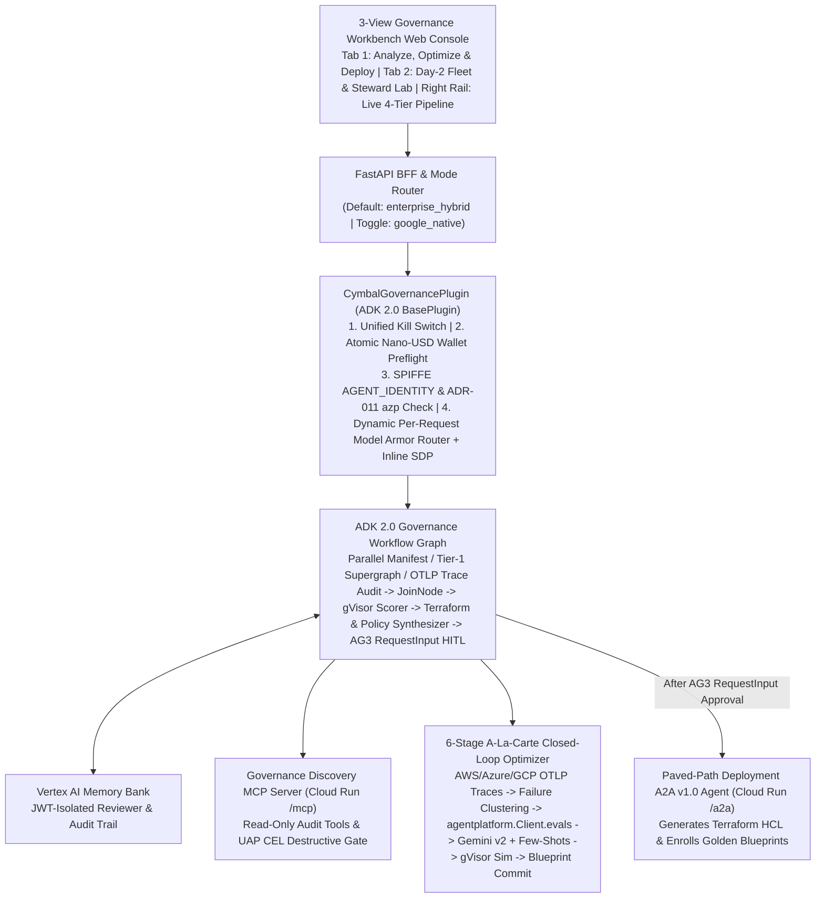

# Cymbal Agent Governance, Optimization & Deployment Workbench (Google Agent Platform & ADK 2.0 Reference)

Production-grade **Agent Governance Analysis, Remediation & Deployment Workbench** and **Day-2 Platform Steward Console** built on **Google ADK 2.0 (`Workflow` Graph Runtime)** and the **Gemini Enterprise Agent Platform** (`gemini-3.8-flash` Long-Term Availability).

This repository defaults to modular, zero-lock-in **4-Tier A-La-Carte Coexistence** paired with a live **9-Service 4-Tier Execution Pipeline** in the web console:
1. **4-Tier A-La-Carte Coexistence (`CYMBAL_PLATFORM_MODE=enterprise_hybrid`, Default)**: Integrates cleanly with mandatory enterprise Tier-1 foundations (Corporate Agent Catalog, Enterprise AI Gateway, OpenTelemetry / Langfuse Collectors, SPIFFE & OIDC `ADR-011` `azp` Identity, Enterprise Wallet, and Kill Switches) while plugging in modular Google Tier-2 & Tier-3 capabilities: **ADK 2.0 `Workflow` Orchestration**, **Native `gVisor` Sandboxes**, **Dynamic Per-Request Model Armor Policy Routing + Inline Cloud SDP**, **Terraform Paved-Path Blueprints (`infra/terraform/`)**, and the **6-Stage Cross-Cloud Closed-Loop Evaluation & Prompt Optimization Engine** (`agentplatform.Client.evals`).
2. **Full GCP-Native Paved Path (`CYMBAL_PLATFORM_MODE=google_native`, Secondary Toggle)**: Demonstrates turnkey end-to-end execution across **Agent Identity (`SPIFFE AGENT_IDENTITY`)**, **Agent Gateway + ACT (`/26` PSC-I) + UAP Policy V2 CEL**, **Agent & Tool Registry**, **Vertex AI Agent Runtime**, **Vertex AI Memory Bank**, **Cloud Run MCP & A2A v1.0 Mesh**, and **Cloud Trace + BigQuery Cost-per-Outcome Wallet**.

---

## 1. Architecture & 4-Tier Coexistence Crosswalk



### 4-Tier Enterprise Pyramid Alignment

| Enterprise Tier | Mandatory / Target Enterprise Layer | Google Agent Platform Alignment | Modular Coexistence Value |
| :--- | :--- | :--- | :--- |
| **Tier 1: Foundation** | Enterprise Catalog, AI Gateway, OTLP / Langfuse, SPIFFE + OIDC, Enterprise Wallet, Kill Switches | `Agent Registry` Sync, `OTLP v1 resourceSpans` Exporter, `AGENT_IDENTITY` + WIF (`ADR-011` `azp`), `Atomic Preflight` | Audits all 6 Tier-1 gates, dual-exports Langfuse/OTLP traces, verifies `azp` correlation across pairwise subjects, and syncs Golden Blueprints. |
| **Tier 2: Control & Runtime** | 4-5 Guardrail Ensemble, Tool Sandboxes, Prompt Registry, Session Memory, Pro-Code Orchestration | **Dynamic Model Armor Router + Cloud SDP**, **ADK 2.0 `Workflow`**, **Native `gVisor` Sandbox**, **UAP CEL**, **Memory Bank** | Compiles per-request BU/risk/SDP JSON policies onto 2 Floor-enforced templates (`$0.10`/1M tokens Ensemble Tier-0 pre-filter), enforces per-tool CEL, and isolates memory by JWT. |
| **Tier 3: Quality & Eval** | Evaluation Platform, Quality Guardrails, CI/CD Experimentation, Observer Agents | **`agentplatform.Client.evals`**, **Prompt & Few-Shot Optimizer**, **gVisor Fault Simulator** | Optimizes OTLP traces generated on AWS, Azure, or GCP without forcing runtime lock-in (`v1=58.0` -> `v2=96.4`). |
| **Tier 4: Infra & Models** | Multi-Cloud Compute, Hybrid Storage, Frontier Models, Dependency Supergraph | **`gemini-3.8-flash` (12-mo LTA)**, **`infra/terraform/` Paved Paths**, **Cloud Run / Vertex Runtime**, **BigQuery** | Ships standardized Terraform Paved-Path modules pre-wired for Catalog registration, Gateway routing, OTLP export, and SPIFFE WIF. |

---

## 2. Five-Minute Quickstart

### Prerequisites
- Python `3.11+`
- Google Cloud SDK (`gcloud >= 500.0.0`) authenticated to a non-production Google Cloud sandbox project with billing enabled

### Step 1: Configure Local Environment
```bash
# Copyright 2026 Google LLC.
# SPDX-License-Identifier: Apache-2.0
cp .env.example .env
# Edit .env and set GOOGLE_CLOUD_PROJECT=<YOUR_SANDBOX_PROJECT_ID>

python3 -m venv .venv
.venv/bin/pip install -e ".[dev]"
```

### Step 2: Provision Infrastructure, Terraform Paved Paths & Services (`us-central1`)
```bash
# Copyright 2026 Google LLC.
# SPDX-License-Identifier: Apache-2.0
# 1. Verify project, billing, and enable required Google Cloud APIs
bash infra/00_argolis_preflight.sh

# 2. Provision GCS, Firestore, BigQuery ledger, Model Armor Floor + Base Pool, and /26 PSC-I VPC
bash infra/01_provision_governance.sh

# 3. Deploy IAM-authenticated Governance MCP (/mcp) & Paved-Path A2A (/a2a) services + register in Agent Registry
bash infra/02_deploy_services.sh

# 4. Provision AgentConnectivityTemplate, AgentGateway, and UAP Policy V2 manifests
bash infra/03_deploy_agent_gateway.sh

# 5. Package & deploy ADK 2.0 Governance Workbench to Vertex AI Agent Runtime (AGENT_IDENTITY)
.venv/bin/python infra/04_deploy_agent_runtime.py

# 6. Deploy IAM/IAP-protected Web Workbench to Cloud Run (cymbal-ops-release-web)
bash infra/05_deploy_web_ui.sh
```

### Step 3: Run Verification Suites, 6-Stage Closed-Loop Optimizer & Local Workbench
```bash
# Copyright 2026 Google LLC.
# SPDX-License-Identifier: Apache-2.0
# Unit, ADK 2.0 Workflow Graph, Dynamic Guardrail Router & Cloud Run Compliance tests
.venv/bin/pytest tests/ -v

# Local pre-flight Web UI security & HITL deployment smoke test on 127.0.0.1
.venv/bin/python scripts/smoke_test_web_ui.py --local

# 6-Stage A-La-Carte Closed-Loop Optimizer (ingests AWS/Azure/GCP OTLP traces -> promotes v2)
.venv/bin/python -m evals.run_closed_loop_eval

# 8-Capability Modular Coexistence Benchmark (writes docs/GOOGLE_AGENT_PLATFORM_BENCHMARK.md)
.venv/bin/python -m evals.run_beyond_scape_proofs

# Launch the Governance Workbench on http://127.0.0.1:8080
.venv/bin/python -m web.api
```

---

## 3. Ten-Minute Executive Live Demo Runbook

1. **Minute 0-3 (Shadow Python Agent Onboarding -> Terraform Paved Path -> AG3 Deployment)**:
   - Open `http://127.0.0.1:8080` (**Tab 1: 1. Analyze, Optimize & Deploy**), defaulted to **4-Tier A-La-Carte Coexistence (`enterprise_hybrid`)**.
   - Select **`CAND-101`** (*Shadow Python Agent Missing Tier-1 Hooks*) and click **Run ADK 2.0 Governance Audit & Paved-Path Build**.
   - Watch the right-hand **4-Tier Pipeline** animate across Tier-1 SPIFFE/OBO verification, Catalog & Gateway UAP checks, OTLP dual-export, 3-way parallel MCP audit, native **gVisor** readiness scoring, and pause at the **AG3 Governance Reviewer Sign-Off Gate** (`RequestInput`).
   - Inspect the generated **Terraform Paved-Path HCL** (`infra/terraform/`) and **Dynamic Per-Request Guardrail Policy JSON**, then click **Approve & Deploy Golden Blueprint** to enroll the agent via the **A2A v1.0 Paved-Path Executor**.
2. **Minute 3-6 (The 'Golden Goose': Cross-Cloud 6-Stage Closed-Loop Eval Optimization)**:
   - Select **`CAND-204`** (*Cross-Cloud AWS/Azure Agent with Failing OTLP Traces*) to show governance-freeze detection without migrating its external cloud runtime.
   - Click **Run 6-Stage Closed-Loop Optimization**: watch the engine ingest AWS, Azure, and GCP OTLP/Langfuse spans, cluster failures, grade `v1` (`58.0 BLOCKED`) via `agentplatform.Client.evals`, dynamically synthesize `v2` rules + few-shot exemplars via `gemini-3.8-flash`, pass `8/8` gVisor adversarial & `503` fault simulations (`96.4`), and commit the **Golden Blueprint** back to the Registry.
3. **Minute 6-8 (Dynamic Per-Request Model Armor Router & Ensemble Pre-Filter TCO)**:
   - Select **`CAND-309`** to observe inline Cloud SDP PII masking (`[REDACTED_PII_SSN:***-**-6789]`) on raw subscriber logs.
   - Switch to **Tab 2: 2. Day-2 Fleet & Steward Lab** -> **Dynamic Per-Request Model Armor Policy Router**: toggle **Business Unit** (`Core Broadband` vs `International Strict`) and **Dynamic SDP PII Action** (`DEIDENTIFY_INLINE` vs `BLOCK_ON_MATCH`) to prove how 2 Floor-enforced base templates serve hundreds of logical BU policies without static template sprawl.
   - Drag the **Ensemble & Tier-0 Pre-Filter TCO Slider** from `1M` to `50M` turns/day (`$0.10` / 1M tokens inline pre-filtering alongside existing ensemble classifiers).
4. **Minute 8-10 (Kill Switch, ADR-011 OBO, 8 Modular Proofs & OTLP Waterfall)**:
   - Click **Run All 8 Live Proofs**, verify `ADR-011` `azp` correlation across divergent pairwise subjects, test **Kill Switch = PAUSED** (`423` upstream halt), and inspect the joined **W3C + OTLP Trace Waterfall** and **Cost-per-Outcome Ledger**.

### Teardown
```bash
# Copyright 2026 Google LLC.
# SPDX-License-Identifier: Apache-2.0
bash infra/99_teardown.sh
```

---

## Disclaimer & License

1. **Non-Production Sample Code Notice**: THIS REPOSITORY AND ALL ACCOMPANYING CODE ARE NOT OFFICIALLY SUPPORTED GOOGLE PRODUCTS AND ARE NOT INTENDED FOR DIRECT PRODUCTION USE. Copyright 2026 Google LLC. Licensed under the Apache License, Version 2.0 (see `LICENSE`). Provided 'AS IS' without warranty, SLA, or ongoing support commitment; you are solely responsible for reviewing, testing, and security-hardening before deploying in your environments. Do not store credentials or PII/PHI in this repository.
2. **Pre-GA / Preview Offerings Notice**: References to Preview features (such as Agent Gateway, Agent Connectivity Templates, and Agent Evaluation) are provided "AS IS" for informational evaluation under the Google Cloud Pre-GA Offerings Terms (`https://cloud.google.com/terms/service-terms`) and may change without notice.
3. **Non-Binding Cost Estimate Notice**: All TCO and guardrail pricing comparisons are illustrative, non-binding budgetary estimates based on public list rates and stated assumptions; actual billing varies with usage, region, and negotiated terms.
