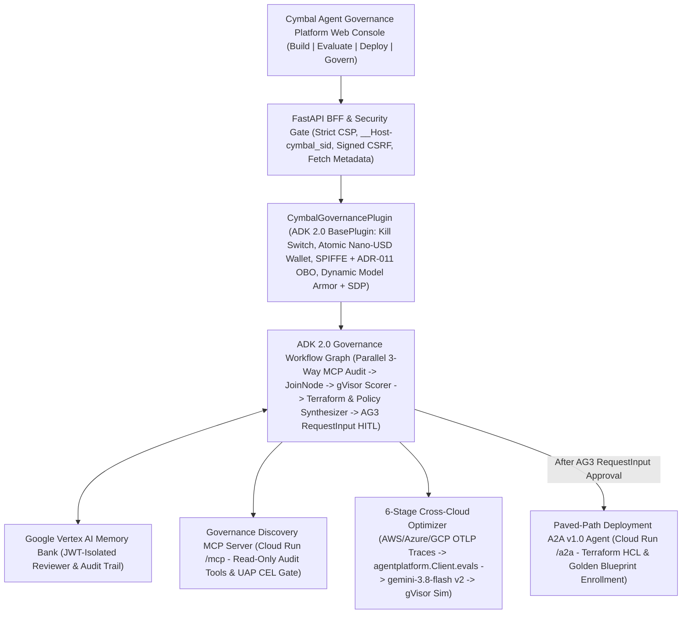

# Cymbal Agent Governance Platform (Google Agent Platform & ADK 2.0 Reference)

> **Engagement & Applicability Notice**: This repository contains non-production Google Cloud Customer Engineering reference architecture and Apache-2.0 sample code provided "AS IS" without warranty or SLA. References to Preview capabilities are governed by the Google Cloud Pre-GA Offerings Terms, and all FinOps / TCO figures represent illustrative, non-binding budgetary estimates. See [Disclaimer & License](#disclaimer--license) for full terms.

Production-grade **Agent Lifecycle Governance, Evaluation, Paved-Path Deployment & Fleet FinOps Console** built on **Google ADK 2.0 (`Workflow` Graph Runtime)** and the **Gemini Enterprise Agent Platform** (`gemini-3.8-flash` Long-Term Availability).

The **Cymbal Agent Governance Platform** (`agent-governance-demo`) unifies Day-0/Day-1 agent onboarding and Day-2 fleet stewardship into a four-stage console (**`Build` -> `Evaluate` -> `Deploy` -> `Govern`**) supporting two architectural postures without runtime lock-in:

1. **`Custom` (4-Tier A-La-Carte Coexistence, Default `CYMBAL_PLATFORM_MODE=enterprise_hybrid`)**: Mixes existing enterprise and open-source components (such as `Okta OIDC + HashiCorp Vault`, `Backstage + ServiceNow CMDB`, `Kong AI Gateway + LiteLLM`, `LangGraph + E2B Firecracker Sandbox`, `Langfuse + OpenTelemetry`, and `Revenium + Helicone`) with high-leverage Google Cloud capabilities (**Dynamic Per-Request Google Model Armor + Cloud SDP**, **ADK 2.0 `Workflow` Orchestration & `gVisor` Sandboxes**, **Terraform Paved-Path Modules (`infra/terraform/`)**, and the **6-Stage Cross-Cloud Trace Evaluation & Prompt Optimizer**).
2. **`Google Cloud` (Turnkey Paved Path, `CYMBAL_PLATFORM_MODE=google_native`)**: Consolidates all 10 functional capabilities onto managed Google Cloud services (**Google Agent Identity (`SPIFFE + WIF`)**, **Google Agent Registry**, **Google Agent Gateway (`/26` PSC-I + UAP Policy V2 CEL)**, **Google Model Armor + Cloud SDP**, **Google Gemini 3.8 Flash**, **Google Agent Runtime (`Agent Engine + gVisor`)**, **Google Vertex AI Memory Bank**, **Google Cloud Trace & Cloud Logging**, **Google Firestore Atomic Wallet & Switch**, and **Google Vertex AI Gen AI Eval & Optimizer**).

---

## 1. Architecture, 4-Stage Lifecycle Console & 10-Capability Crosswalk



### 10 Functional Capabilities (Third-Party / OSS vs. Google Cloud)

| # | Functional Capability | Pillar | Third-Party / OSS Option (`Custom`) | Google Cloud Option (`Google Cloud`) | Coexistence & Consolidation Value |
| :---: | :--- | :--- | :--- | :--- | :--- |
| **1** | **Identity & Access** | Control | `Okta OIDC + HashiCorp Vault` | `Google Agent Identity (SPIFFE + WIF)` | Eliminates static secrets via platform-minted SPIFFE SVIDs and verifies `ADR-011` `azp` correlation across pairwise OBO tokens. |
| **2** | **Agent Registry** | Control | `Backstage + ServiceNow CMDB` | `Google Agent Registry` | Bidirectional CMDB / intake verification (`ATLAS` + `ServiceAtlas`) and versioned Golden Blueprint synchronization. |
| **3** | **AI & Tool Gateway** | Control | `Kong AI Gateway + LiteLLM` | `Google Agent Gateway (PSC-I + UAP CEL)` | Private `/26` PSC-I egress with UAP Policy V2 CEL rules permitting `readOnlyHint=true` MCP tools while blocking destructive calls (`403`). |
| **4** | **Safety Guardrails** | Control | `Guardrails AI + Microsoft Presidio` | `Google Model Armor + Cloud SDP` | Routes per-request BU/risk/SDP JSON policies onto 3 Floor-enforced templates (`$0.10` / 1M tokens Tier-0 pre-filter + inline PII redaction; standalone middleware adapter in `services/gateway_tier0_model_armor/`). |
| **5** | **Foundation Model** | Intelligence | `OpenAI GPT-4o / Meta Llama (vLLM)` | `Google Gemini 3.8 Flash (Vertex AI)` | 12-month Long-Term Availability (`gemini-3.8-flash`) with enterprise data governance and predictable low-latency reasoning. |
| **6** | **Runtime & Sandbox** | Experience | `LangGraph + E2B Firecracker Sandbox` | `Google Agent Runtime (Agent Engine + gVisor)` | Managed ADK 2.0 `Workflow` graph execution, resumable `RequestInput` HITL checkpoints, and native `gVisor` code sandboxing. |
| **7** | **Memory & Knowledge** | Intelligence | `Mem0 + Redis Vector Store` | `Google Vertex AI Memory Bank` | Longitudinal compliance & reviewer memory strictly isolated by verified JWT `user_id` (`0` cross-tenant leakage). |
| **8** | **Observability & Tracing** | Control | `Langfuse + OpenTelemetry` | `Google Cloud Trace & Cloud Logging` | Dual-exports W3C TraceContext and OTLP v1 `resourceSpans` across multi-cloud runtimes. |
| **9** | **Cost & Kill Controls** | Economics | `Revenium + Helicone` | `Google Firestore Atomic Wallet & Switch` | Pre-inference atomic nano-USD budget reservation (`403` on cap breach) and sub-second global `ACTIVE / PAUSED / DISABLED` kill switch (`423`). |
| **10** | **Evaluation & Optimization** | Intelligence | `LangSmith + Promptfoo` | `Google Vertex AI Gen AI Eval & Optimizer` | 6-stage closed-loop engine grading AWS/Azure/GCP OTLP traces concurrently across 8 golden cases via `agentplatform.Client.evals` and promoting `v2` prompts. |

### Unified Console Design Rubric (`Build`, `Evaluate`, `Deploy`, `Govern`)

Every stage in the web console follows a consistent, scannable interaction model:
- **Universal Per-Column Sort, Inline `<thead>` Filtering & Pagination**: Every primary and nested table provides type-aware `<th aria-sort>` sorting (dates, numbers/USD, text), inline `<select>` and `<input type="search">` filters (supporting substring match and numeric operators such as `>=85` or `<=3500`), and `10 / 25 / 50` pagination over `27` newest-first `Draft` and `Deployed` agent instances.
- **`Build` (`/build`)**: Select any agent row to expand its instance toolbar (`Template: [Google Cloud | Custom]`, `Import Manifest`, `Export YAML`, `Save`, `Evaluate Agent ->`), **10 Horizontal Functional Blocks**, **Agent Instance Metadata**, and **10 Nested `<details>` Component Expanders**.
- **`Evaluate` (`/evaluate`)**: Select any agent row to expand its action bar (`Open in Build`, `Optimize Prompt & Traces`, `Run ADK Workflow Audit`, `Proceed to Deploy ->`), 5 Readiness & Pillar KPIs, **10 Horizontal Status Blocks** (`[OK]` / `[~]` / `[!]`), and **10 Nested `<details>` Rule & Remediation Expanders** (`RUB-01`..`RUB-10` with `Apply Recommended Fix` and `Record Exception`).
- **`Deploy` (`/deploy`)**: Select any agent row to expand **4 Nested `<details>` Expanders**: `1. Release Gate & Production Approval` (4 run-rate/savings KPIs + baseline-aligned `Approver Principal`, `Release Change / Approval Ticket`, and `Deploy Agent to Fleet`), `2. Generated Terraform Module (infra/terraform)`, `3. Dynamic Guardrail Policy Payload`, and `4. 10-Component Cost & Consolidation Attribution`.
- **`Govern` (`/govern`)**: **4 Horizontal Governance Domain Blocks** synced to **4 Exclusive `<details>` Domain Expanders**: `1. Policies & Rubric` (live passing threshold + inline-expandable 10-rule rubric editor), `2. Fleet Operations` (`2.1 10-Capability Component Adoption` with inline per-capability fleet drill-down + `2.2 Fleet Deployment Audit Log`), `3. FinOps & Economics` (`3.1 Pillar & 10-Component Spend Attribution`, `3.2 Per-Agent Deployment Cost Ledger`, `3.3 Guardrail Scale Economics Simulator`), and `4. Runtime Controls` (`4.1 Global Containment, Atomic Budget & ADR-011 OBO`, `4.2 Dynamic Guardrail & Inline PII Policy Tester`, `4.3 Live Control Plane Verification Checks (8)`, `4.4 Control Plane Service Topology (9 Runtime Services)`).

---

## 2. Five-Minute Quickstart

### Prerequisites
- Python `3.11+`
- Google Cloud SDK (`gcloud >= 500.0.0`) authenticated to a non-production Google Cloud sandbox project with billing enabled

### Step 1: Configure Local Environment
```bash
# Copyright 2026 Google LLC.
# SPDX-License-Identifier: Apache-2.0
cp .env.example .env
# Edit .env and set GOOGLE_CLOUD_PROJECT=<YOUR_SANDBOX_PROJECT_ID>

python3 -m venv .venv
.venv/bin/pip install -e ".[dev]"
```

### Step 2: Provision Infrastructure, Terraform Paved Paths & Services (`us-central1`)
```bash
# Copyright 2026 Google LLC.
# SPDX-License-Identifier: Apache-2.0
# 1. Verify project, billing, and enable required Google Cloud APIs
bash infra/00_argolis_preflight.sh

# 2. Provision GCS, Firestore, BigQuery ledger, Model Armor Floor + Base Pool, and /26 PSC-I VPC
bash infra/01_provision_governance.sh

# 3. Deploy IAM-authenticated Governance MCP (/mcp) & Paved-Path A2A (/a2a) services + register in Agent Registry
bash infra/02_deploy_services.sh

# 4. Provision AgentConnectivityTemplate, AgentGateway, and UAP Policy V2 manifests
bash infra/03_deploy_agent_gateway.sh

# 5. Package & deploy ADK 2.0 Governance Runtime (agent-governance-demo) to Vertex AI Agent Engine
.venv/bin/python infra/04_deploy_agent_runtime.py

# 6. Deploy IAM/IAP-protected Cymbal Agent Governance Platform Web UI to Cloud Run (cymbal-ops-release-web)
bash infra/05_deploy_web_ui.sh
```

### Step 3: Run Verification Suites, 6-Stage Closed-Loop Optimizer & Local Console
```bash
# Copyright 2026 Google LLC.
# SPDX-License-Identifier: Apache-2.0
# Unit, ADK 2.0 Workflow Graph, Tier-0 Gateway Adapter, Dynamic Guardrail & Cloud Run Compliance tests (45+ tests)
CYMBAL_RUNTIME_STATE_DIR=/tmp/cymbal_pytest_state CYMBAL_BFF_OFFLINE=true .venv/bin/pytest tests/ -v

# Local pre-flight Web UI security, CSP, CSRF & HITL deployment smoke test on 127.0.0.1
CYMBAL_RUNTIME_STATE_DIR=/tmp/cymbal_smoke_state .venv/bin/python scripts/smoke_test_web_ui.py --local --offline

# Deterministic Apache-2.0 header, zero-leak & disclaimer compliance gate
.venv/bin/python scripts/verify_repo_compliance.py

# One-command live demo reset, Gemini/Model Armor/Cloud Run warmup & local console launcher
.venv/bin/python scripts/demo_reset_and_warmup.py

# 6-Stage Cross-Cloud Closed-Loop Optimizer (ingests AWS/Azure/GCP OTLP traces -> promotes v2)
.venv/bin/python -m evals.run_closed_loop_eval

# 8-Capability Modular Coexistence Benchmark (writes docs/GOOGLE_AGENT_PLATFORM_BENCHMARK.md)
.venv/bin/python -m evals.run_beyond_scape_proofs

# Or launch the Cymbal Agent Governance Platform Web UI directly on http://127.0.0.1:8080
.venv/bin/python -m web.api
```

---

## 3. Ten-Minute Executive Live Demo Runbook

1. **Minute 0-3 (`Build` - Fleet Inventory, `Google Cloud` vs. `Custom` Templates & Shadow Agent Intake)**:
   - Open **`/build`** (`http://127.0.0.1:8080/build` or your Cloud Run HTTPS URL) to view the `27` registered `Draft` and historical `Deployed` agent instances sorted newest-first (`live-stream-ad-insertion-agent`, `example-agent-1`, `network-telemetry-advisor`, `fiber-cut-dispatch-coordinator`, `billing-dispute-assistant`). Use the inline `<thead>` column filters (for example, filtering `Status = Draft` or `SENTINEL Agency Tier = ag3`).
   - Click **`billing-dispute-assistant`** (or click **`+ New Agent`** / **`Import Manifest`** inside an expanded row) to open its inline instance editor.
   - Walk through the **10 Horizontal Functional Blocks** and **10 Nested Component Expanders**, comparing `Custom` third-party/OSS selections (`Okta OIDC + HashiCorp Vault`, `Kong AI Gateway + LiteLLM`, `LangGraph + E2B Firecracker Sandbox`, etc.) against `Google Cloud` components (`Google Agent Identity (SPIFFE + WIF)`, `Google Agent Gateway (PSC-I + UAP CEL)`, `Google Agent Runtime (Agent Engine + gVisor)`), toggle **`Template: [Google Cloud | Custom]`**, and click **`Evaluate Agent ->`**.
2. **Minute 3-6 (`Evaluate` - 10-Rule Governance Gate, 6-Stage `gemini-3.8-flash` Optimizer & ADK 2.0 Audit)**:
   - In the auto-expanded **`billing-dispute-assistant`** row on **`/evaluate`**, review the 5 Readiness & Pillar KPIs (`Control`, `Intelligence`, `Economics`, `Experience`), the **10 Horizontal Status Blocks** (`[OK]` / `[~]` / `[!]`), and the **10 Nested Rule & Remediation Expanders** (`RUB-01`..`RUB-10`).
   - Remediate blocking gates via **`Apply Recommended Fix`** (or record an architecture variance via **`Record Exception`**) and watch the readiness score and monthly run-rate delta update live.
   - Click **`Optimize Prompt & Traces`** to execute the 6-stage cross-cloud OTLP trace evaluation & prompt optimizer (concurrent 8-case `agentplatform.Client.evals` + `gemini-3.8-flash` live synthesis), click **`Run ADK Workflow Audit`** to run the 3-way parallel MCP + `gVisor` audit and stage the `AG3` `RequestInput` approval checkpoint, then click **`Proceed to Deploy ->`**.
3. **Minute 6-8 (`Deploy` - AG3 HITL Checkpoint, Terraform Paved-Path HCL, Guardrail JSON & Fleet Promotion)**:
   - Inside **`1. Release Gate & Production Approval`** on **`/deploy`**, review **Projected Monthly Run-Rate**, **One-Time Onboarding & Eval**, **Monthly Consolidation Delta**, and **`AG3`** sign-off posture.
   - Expand **`2. Generated Terraform Module (infra/terraform)`** and **`3. Dynamic Guardrail Policy Payload`** to inspect the synthesized Paved-Path HCL and per-request Google Model Armor + Cloud SDP JSON.
   - Enter the approver principal and change ticket, approve the staged ADK `AG3` checkpoint if present, and click **`Deploy Agent to Fleet`** to promote the agent to `Deployed` at the top of the fleet table and open **`4. 10-Component Cost & Consolidation Attribution`**.
4. **Minute 8-10 (`Govern` - Live Rubric Policy Tuning, Fleet Adoption, FinOps Attribution & Runtime Controls)**:
   - Navigate to **`/govern`** and step across the **4 Horizontal Governance Domain Blocks** synced to the **4 Exclusive `<details>` Domain Expanders**:
     - **`1. Policies & Rubric`**: Expand any rule row (`RUB-01`..`RUB-10`) to edit its gate type (`Mandatory Gate` vs. `Advisory`), weight, or `Passing Readiness Score Threshold` (`>= 85`), demonstrating immediate live enforcement across `Evaluate` and `Deploy`.
     - **`2. Fleet Operations`**: Open `2.1 10-Capability Component Adoption` and expand any capability row to inspect per-agent vendor/OSS vs. Google Cloud adoption, then review `2.2 Fleet Deployment Audit Log`.
     - **`3. FinOps & Economics`**: Expand a capability in `3.1 Pillar & 10-Component Spend Attribution` to view top contributing agents, inspect `3.2 Per-Agent Deployment Cost Ledger`, and run `3.3 Guardrail Scale Economics Simulator` (`1M` to `50M` daily turns at `$0.10` / 1M tokens).
     - **`4. Runtime Controls`**: Test `4.2 Dynamic Guardrail & Inline PII Policy Tester` (`DEIDENTIFY_INLINE` vs. `BLOCK_ON_MATCH`), execute `4.3 Live Control Plane Verification Checks (8)` and `Verify OBO Token Pair (ADR-011)`, toggle `4.1 Global Containment` (`PAUSED` -> `423` upstream halt, then restore `ACTIVE`), and review `4.4 Control Plane Service Topology (9 Runtime Services)`.

### Teardown
```bash
# Copyright 2026 Google LLC.
# SPDX-License-Identifier: Apache-2.0
bash infra/99_teardown.sh
```

---

## Disclaimer & License

1. **Non-Production Sample Code Notice**: THIS REPOSITORY AND ALL ACCOMPANYING CODE ARE NOT OFFICIALLY SUPPORTED GOOGLE PRODUCTS AND ARE NOT INTENDED FOR DIRECT PRODUCTION USE. Copyright 2026 Google LLC. Licensed under the Apache License, Version 2.0 (see `LICENSE`). Provided 'AS IS' without warranty, SLA, or ongoing support commitment; you are solely responsible for reviewing, testing, and security-hardening before deploying in your environments. Do not store credentials or PII/PHI in this repository.
2. **Sandbox & Evaluation Governance Notice**: Any proof-of-concept or sandbox deployment must run strictly in an isolated non-production environment using synthetic or non-regulated test data (zero live PII, PHI, or payment data) with least-privilege IAM roles (excluding `roles/owner` and `roles/editor`), governed by the Google Cloud Service Specific Terms ("Free Evaluation Services" at `https://cloud.google.com/terms/service-terms`).
3. **AI Evaluation & Model Exclusivity Notice**: Customer retains sole access and ownership over any prompt blueprints, evaluation datasets, or model adaptations created using customer-provided data in customer's Google Cloud project; Google Customer Engineering does not retain or reuse customer artifacts outside the engagement.
4. **Pre-GA / Preview Offerings Notice**: References to Preview features (such as Agent Gateway, Agent Connectivity Templates, and Agent Evaluation) are provided "AS IS" for informational evaluation under the Google Cloud Pre-GA Offerings Terms (`https://cloud.google.com/terms/service-terms`) and may change without notice.
5. **Non-Binding Cost Estimate Notice**: All TCO and guardrail pricing comparisons are illustrative, non-binding budgetary estimates based on public list rates and stated assumptions; actual billing varies with usage, region, and negotiated terms.
