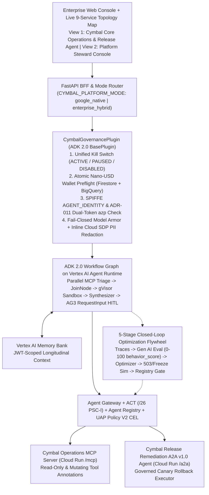

# Cymbal Core Operations & Release Agent (Google Agent Platform & ADK 2.0 Reference)

Production-grade **Cymbal Core Operations & Release Agent** and **Google Agent Platform Steward Console** built on **Google ADK 2.0 (`Workflow` Graph Runtime)** and the **Gemini Enterprise Agent Platform** (`gemini-3.8-flash` Long-Term Availability).

This repository demonstrates two operating modes from a single codebase, paired with an interactive **9-Service Live Platform Topology Visualization** in the web UI:
1. **Google-Native Full Platform (`CYMBAL_PLATFORM_MODE=google_native`, Default)**: Unified Tier 1 through Tier 4 enterprise agent governance across **Agent Identity (`SPIFFE AGENT_IDENTITY`)**, **Model Armor + Cloud SDP + Floor Settings**, **Agent Gateway + ACT (`PRIVATE_RANGES_ONLY`) + UAP Policy V2 CEL**, **Agent & Tool Registry**, **Vertex AI Agent Runtime (`ReasoningEngine` + native `gVisor` sandbox + `RequestInput` HITL)**, **Vertex AI Memory Bank**, **Cloud Run MCP & A2A v1.0 Mesh**, **Cloud Trace + BigQuery Cost-per-Outcome Wallet**, and the **Closed-Loop Evaluation & Optimization Flywheel**.
2. **Enterprise Hybrid Coexistence (`CYMBAL_PLATFORM_MODE=enterprise_hybrid`, Config Toggle)**: Modular adoption alongside an existing enterprise AI gateway, enforcing `ADR-011` dual-token `azp` correlation (`Authorization: Bearer <T-gw>` + `X-User-Authorization: Bearer <T-mcp>`), single-guardrail passthrough (`safety_settings=OFF` so Model Armor acts as the single deterministic policy plane), and dual OTLP session correlation headers (`X-Trace-Session-Id`).

---

## 1. Architecture & 9-Service Google Agent Platform Crosswalk



### Service-by-Service Platform Comparison

| Layer | Multi-System / DIY Baseline | Google Agent Platform Managed Service | Specialist Vendor Categories Consolidated |
| :--- | :--- | :--- | :--- |
| **1. Agent Identity & Secrets** | Static bearer keys or custom per-pod OBO sidecars with pairwise `sub` mismatches. | **Agent Identity (`SPIFFE AGENT_IDENTITY`) + `ADR-011` `azp` Check**: Zero static secrets or sidecars inside the agent container. | `Keycard`, custom sidecars, `Vault` |
| **2. Safety & Guardrails** | Cross-cloud guardrail hairpins (~`$1,000` / 1M turns), fail-open defaults, text-only scan. | **Model Armor + Cloud SDP + Floor Settings**: `$0.10` / 1M tokens (`90%` lower vs Azure), inline SSN/MAC PII masking, 40-URL phishing scan, strict fail-closed floor. | `Straiker.ai`, cross-cloud safety APIs |
| **3. AI & MCP Gateway** | Opt-in HTTP proxy with coarse `mcp.use` pool scopes and container egress bypass risk. | **Agent Gateway + ACT + UAP Policy V2 CEL**: Un-bypassable PSC-I network attachment and per-tool `read_only_hint` vs `destructive_hint` CEL rules. | `Agentgateway`, `Runlayer`, `Arcade`, `Hush` |
| **4. Registry & Inventory** | Split across disconnected catalogs with unaligned agent IDs and manual sync steps. | **Agent & Tool Registry** (`agentregistry.googleapis.com`): 1 canonical resource identity driving discovery, routing, and policy. | Custom catalog glue |
| **5. Orchestration & Sandbox** | Stateless request wrappers without durable HITL pause/resume or isolated code sandboxes. | **Vertex AI Agent Runtime (ADK 2.0 `Workflow` + `JoinNode` + `RequestInput` + gVisor Sandbox)**: Typed parallel graphs, multi-hour HITL resume, native Python sandbox. | `E2B` MicroVMs, custom state glue |
| **6. Agent Memory** | Stateless sessions requiring external vector/graph stores and custom ABAC wrappers. | **Vertex AI Memory Bank**: Turnkey longitudinal memory strictly isolated by authenticated JWT `user_id`. | `Mem0`, `Memori` |
| **7. Governed Tool & A2A Mesh** | Unauthenticated webhooks and direct tool calls bypassing policy enforcement. | **Cloud Run MCP (`/mcp`) & A2A v1.0 (`/a2a`) Mesh**: IAM-authenticated StreamableHTTP MCP tools and AG3-gated canary rollback executor. | Custom webhook glue |
| **8. Telemetry & Wallet** | Separate guardrail vs agent trace stores and post-response Valkey spend lag. | **Cloud Trace + Atomic Firestore Preflight + BigQuery Wallet Ledger**: Single W3C trace join, `403 budget_exceeded` preflight cap, and Cost-per-Resolved-Incident ROI. | `Revenium`, `Ascerta` |
| **9. Eval & Simulation** | Static CI YAML tests without live trace ingestion, fault injection, or prompt synthesis. | **Gen AI Eval Service + Prompt Optimizer + Fault Simulator**: Automated `0-100 behavior_score` gating `v1 (58.0)` -> `v2 (96.2)`. | `Veris`, `LangSmith` |

---

## 2. Five-Minute Quickstart

### Prerequisites
- Python `3.11+`
- Google Cloud SDK (`gcloud >= 500.0.0`) authenticated to a non-production Google Cloud sandbox project with billing enabled

### Step 1: Configure Local Environment
```bash
# Copyright 2026 Google LLC.
# SPDX-License-Identifier: Apache-2.0
cp .env.example .env
# Edit .env and set GOOGLE_CLOUD_PROJECT=<YOUR_SANDBOX_PROJECT_ID>

python3 -m venv .venv
.venv/bin/pip install -e ".[dev]"
```

### Step 2: Provision Infrastructure & Deploy Services (`us-central1`)
```bash
# Copyright 2026 Google LLC.
# SPDX-License-Identifier: Apache-2.0
# 1. Verify project, billing, and enable required Google Cloud APIs
bash infra/00_argolis_preflight.sh

# 2. Provision GCS, Firestore, BigQuery ledger, Model Armor GPP templates + Floor, and /26 PSC-I VPC
bash infra/01_provision_governance.sh

# 3. Deploy IAM-authenticated Cloud Run MCP (/mcp) & A2A (/a2a) services + register in Agent Registry
bash infra/02_deploy_services.sh

# 4. Provision AgentConnectivityTemplate, AgentGateway, and UAP Policy V2 manifests
bash infra/03_deploy_agent_gateway.sh

# 5. Package & deploy Cymbal Core Operations & Release Agent to Vertex AI Agent Runtime (AGENT_IDENTITY)
.venv/bin/python infra/04_deploy_agent_runtime.py

# 6. Smoke-test locally and deploy standardized IAP/IAM-protected Web UI to Cloud Run (cymbal-ops-release-web)
bash infra/05_deploy_web_ui.sh
```

### Step 3: Run Local Development, Smoke Tests, Closed-Loop Flywheel & Benchmark Suite
```bash
# Copyright 2026 Google LLC.
# SPDX-License-Identifier: Apache-2.0
# Unit, ADK 2.0 Workflow Graph & Cloud Run Web Compliance tests
.venv/bin/pytest tests/ -v

# Local pre-flight Web UI smoke & security test on 127.0.0.1
.venv/bin/python scripts/smoke_test_web_ui.py --local

# 5-Stage Closed-Loop Optimization Flywheel (promotes v1 -> v2 in <90s)
.venv/bin/python -m evals.run_closed_loop_eval

# 8-Capability Differential Benchmark (writes docs/GOOGLE_AGENT_PLATFORM_BENCHMARK.md)
.venv/bin/python -m evals.run_beyond_scape_proofs

# Launch the local Cymbal Web Console + Vertical 9-Service Pipeline on http://127.0.0.1:8080
.venv/bin/python -m web.api
```

---

## 3. Ten-Minute Executive Live Demo Runbook

1. **Minute 0-3 (Live 9-Service Topology + Parallel MCP + gVisor + Resumable AG3 HITL)**:
   - Open `http://127.0.0.1:8080` (**View 1: 1. Operations & Release Agent**).
   - Inspect the **Google Agent Platform Live Services Topology** at the top of the workspace showing all 9 managed services (`Agent Identity`, `Model Armor + SDP`, `Agent Gateway + ACT + UAP`, `Agent & Tool Registry`, `Vertex AI Agent Runtime`, `Vertex AI Memory Bank`, `Cloud Run MCP & A2A Mesh`, `Cloud Trace & Atomic Wallet`, `Gen AI Eval & Optimizer`).
   - Select **`INC-4092`** (`cymbal-release-api` gateway p99 spike to `4,820ms` & Valkey `usage:0` saturation at `94.6%`) and click **Execute ADK 2.0 Workflow Triage**.
   - Watch the live topology animate step-by-step across SPIFFE verification, Model Armor inspection, Memory Bank recall, 3-way parallel MCP fan-out + `JoinNode`, native **gVisor** z-score math, and pause in amber (`PAUSED_HITL`) at **SENTINEL AG3 Human Authorization Gate** (`RequestInput`). Click any service node to inspect live API telemetry and latencies.
   - Click **Approve Canary Rollback** to watch the checkpointed graph resume through **Agent Gateway** into the **A2A v1.0 Remediation Agent** (`v2.14.3 -> v2.14.2`, post-rollback p99 `298ms`), persist longitudinal memory, and settle `Cost-per-Resolved-Incident` in BigQuery.
2. **Minute 3-5 (Inline Cloud SDP PII Redaction & Change-Freeze Governance)**:
   - Select **`INC-4099`** (raw log paste containing subscriber SSN and CPE MAC address) and run triage: watch **Model Armor + Cloud SDP** highlight `MASKED_PII` (`[REDACTED_PII_SSN:***-**-6789]`) inline before Gemini exposure and complete as `AG1` advisory without unnecessary rollback.
   - Select **`INC-4095`** (`billing-webhook-router` during Cymbal Peak Change Freeze): show `v2` surfacing the red **VP Change-Freeze Exception** hold banner.
3. **Minute 5-8 (Platform Steward Console: Fail-Closed Controls, 8 Live Proofs & Guardrail TCO)**:
   - Switch to **View 2: 2. Platform Steward Console** and click **Run All 8 Live Proofs** (or click individual proofs) while watching the corresponding services light up in the topology map.
   - Test a Base64 prompt injection in the **Live Model Armor Threat Sanitizer** or toggle **Global Kill Switch = PAUSED** to see `BLOCKED` fail-closed enforcement halt upstream before runtime spend occurs.
   - Drag the **Enterprise Volume TCO Slider** from `1M` to `50M` turns/day to show transparent list-price guardrail savings (`$3.285M/yr` saved at `10M` turns/day vs Azure Content Safety).
4. **Minute 8-10 (Closed-Loop Optimization Flywheel & Hybrid Coexistence)**:
   - Click **Run Closed-Loop Optimization**: watch the feedback loop (`Cloud Trace -> Gen AI Eval -> Agent Registry -> Agent Runtime`) block `v1` (`58.0`), synthesize `v2` (`96.2`), pass `8/8` adversarial & `503` simulations, and promote `v2` into **Agent Registry**.
   - Toggle **Architecture Mode** to **Enterprise Hybrid Coexistence (`enterprise_hybrid`)** to demonstrate `ADR-011` dual-token `azp` correlation alongside existing gateways.

### Teardown
```bash
# Copyright 2026 Google LLC.
# SPDX-License-Identifier: Apache-2.0
bash infra/99_teardown.sh
```

---

## Disclaimer & License

1. **Non-Production Sample Code Notice**: THIS REPOSITORY AND ALL ACCOMPANYING CODE ARE NOT OFFICIALLY SUPPORTED GOOGLE PRODUCTS AND ARE NOT INTENDED FOR DIRECT PRODUCTION USE. Copyright 2026 Google LLC. Licensed under the Apache License, Version 2.0 (see `LICENSE`). Provided 'AS IS' without warranty, SLA, or ongoing support commitment; you are solely responsible for reviewing, testing, and security-hardening before deploying in your environments. Do not store credentials or PII/PHI in this repository.
2. **Pre-GA / Preview Offerings Notice**: References to Preview features (such as Agent Gateway, Agent Connectivity Templates, and Agent Evaluation) are provided "AS IS" for informational evaluation under the Google Cloud Pre-GA Offerings Terms (`https://cloud.google.com/terms/service-terms`) and may change without notice.
3. **Non-Binding Cost Estimate Notice**: All TCO and guardrail pricing comparisons are illustrative, non-binding budgetary estimates based on public list rates and stated assumptions; actual billing varies with usage, region, and negotiated terms.
